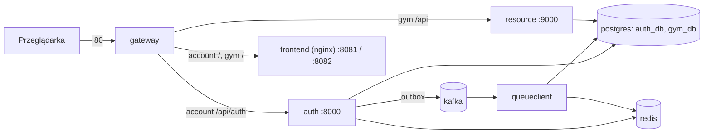

# Uruchomienie w Dockerze

Cały ekosystem (4 serwisy Spring Boot, 2 frontendy React, PostgreSQL, Redis, Kafka) startuje jednym poleceniem.

## Wymagania

- [Docker Desktop](https://www.docker.com/products/docker-desktop/) (lub Docker Engine + Compose v2)
- Wolny port **80**

## 1. Wpisy w pliku hosts

Aplikacja działa na subdomenach `*.mojprojekt.test` (cookies SSO są współdzielone w domenie `.mojprojekt.test`), więc trzeba je skierować na localhost:

```
127.0.0.1 account.mojprojekt.test
127.0.0.1 gym.mojprojekt.test
```

- **Windows:** `C:\Windows\System32\drivers\etc\hosts` (edytor uruchomiony jako administrator)
- **Linux / macOS:** `/etc/hosts` (`sudo`)

## 2. Start

```bash
docker compose up --build
```

Pierwsze budowanie trwa kilka minut (Maven + yarn). Gdy w logach pojawi się `Started GatewayApplication`, otwórz:

| Adres | Co to jest |
| --- | --- |
| http://account.mojprojekt.test | Konto / SSO (rejestracja, logowanie, sesje, ustawienia) |
| http://gym.mojprojekt.test | Aplikacja Gym (ćwiczenia, plany, treningi) |

## Architektura kontenerów



Na zewnątrz wystawiony jest wyłącznie gateway (port 80).

## Przydatne polecenia

```bash
docker compose logs -f auth gateway   # logi wybranych serwisów
docker compose down                   # zatrzymanie
docker compose down -v                # zatrzymanie + usunięcie danych (bazy, redis)
```

Hasła do Postgresa i Redisa można zmienić zmiennymi `DB_PASSWORD` i `REDIS_PASSWORD` (np. w pliku `.env` obok `compose.yaml`). Domyślnie: `admin`.

## Praca lokalna (bez konteneryzacji aplikacji)

Sama infrastruktura (Postgres, Kafka, Redis, RedisInsight wystawione na localhost) dla uruchamiania serwisów z IDE:

```bash
docker compose -f compose.infra.yaml up
```
