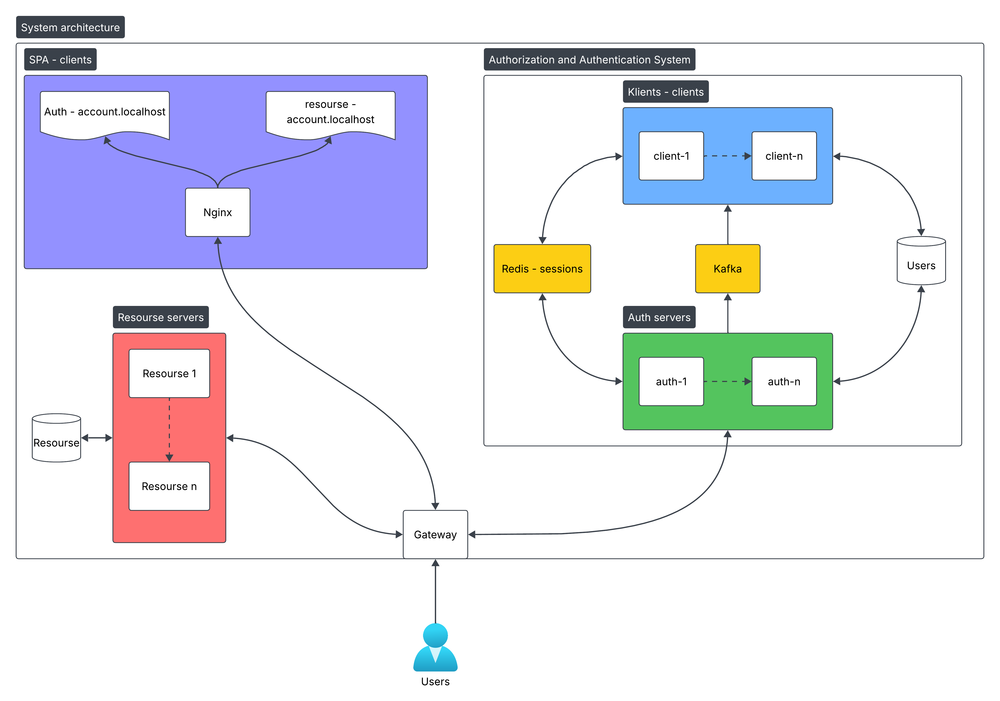
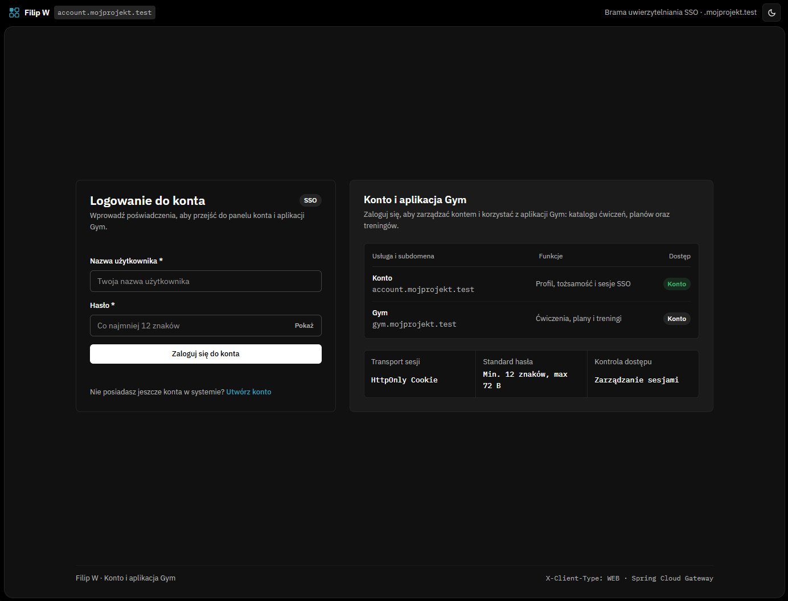
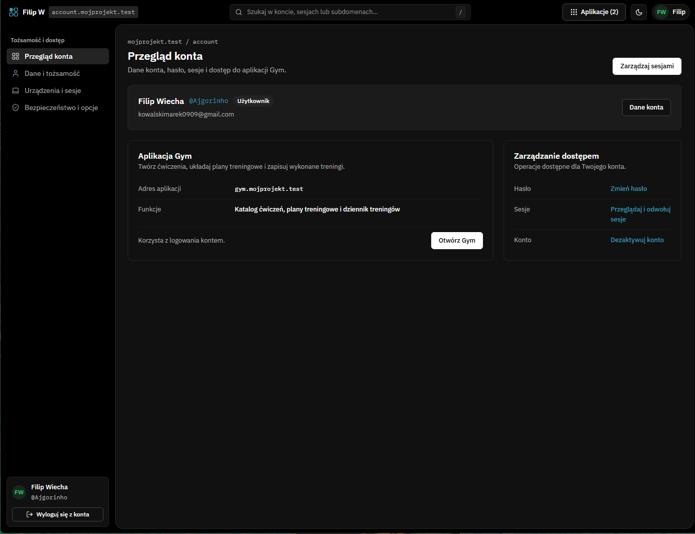
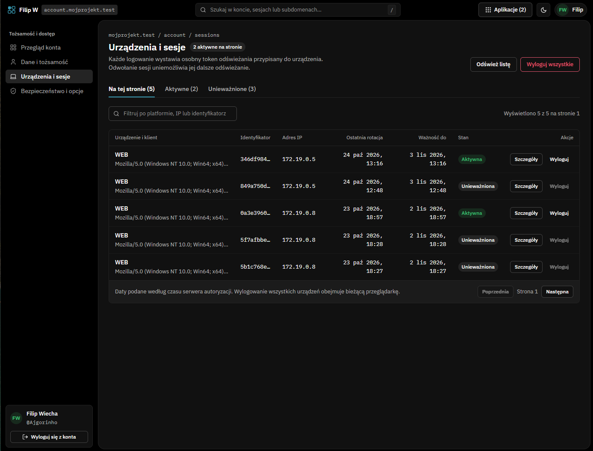
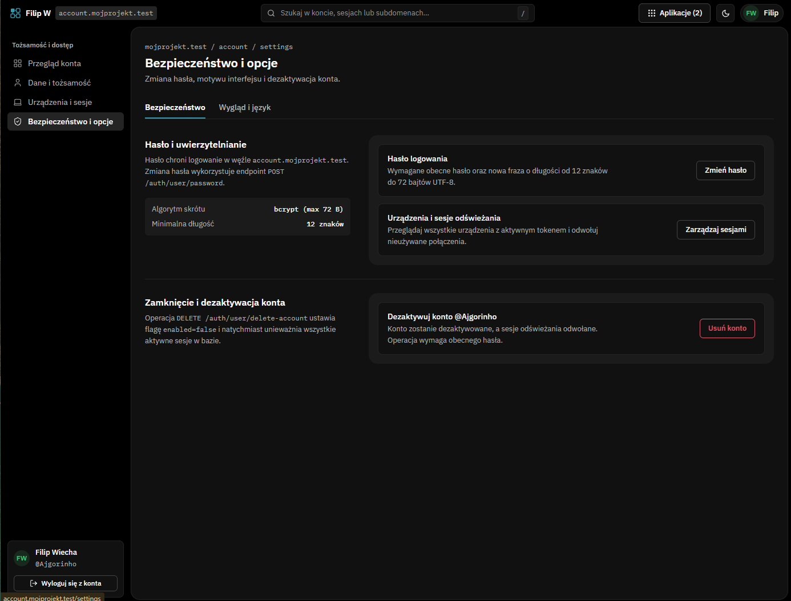
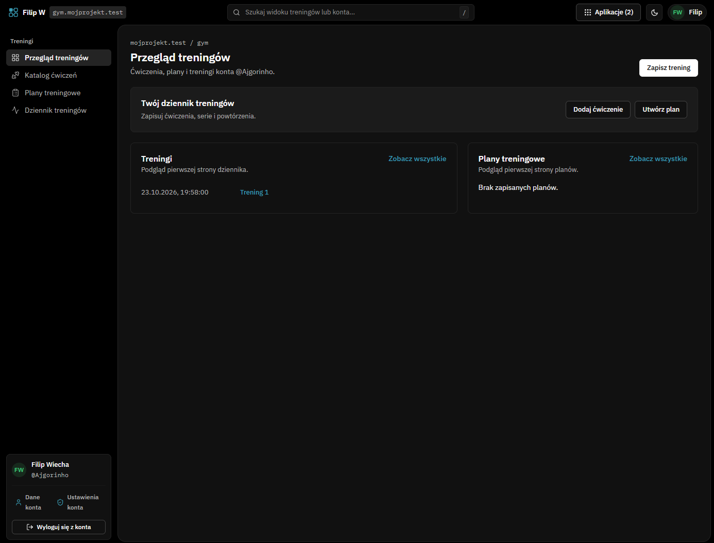
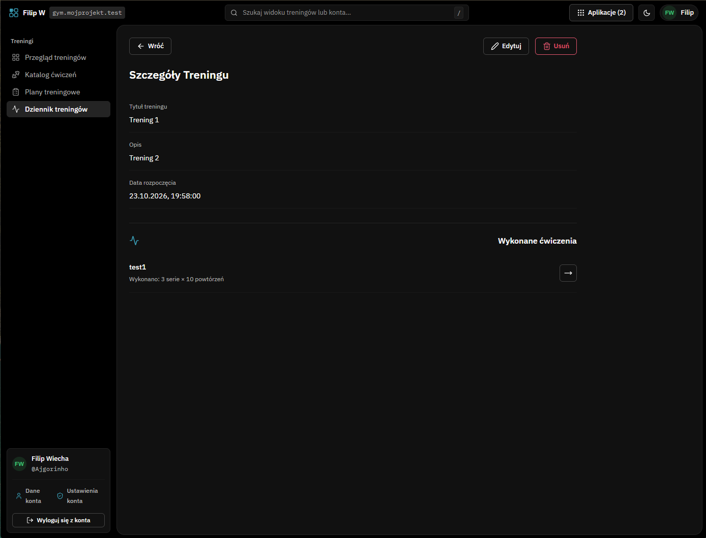

# Rozproszony system uwierzytelniania i autoryzacji

Projekt własny: system uwierzytelniania i autoryzacji zbudowany w architekturze rozproszonej, wraz z przykładową aplikacją treningową (treningi, plany treningowe, ćwiczenia).

Główne założenia:

- serwery uwierzytelniania (`auth`) można **powielać dowolnie**, ponieważ są bezstanowe (JWT) i współdzielą sesje w Redis,
- operacje na sesjach (tworzenie, rotacja, unieważnianie) są wykonywane w Redis, a **użytkownik nie czeka na zapis do bazy danych**,
- jedno API obsługuje klientów webowych i mobilnych.

## Architektura



| Komponent | Opis |
|---|---|
| **gateway** | Główny punkt wejścia dla użytkownika. Kieruje ruch do serwerów `auth` i `resource`. |
| **auth** | Serwer uwierzytelniania i autoryzacji. Wydaje access token (JWT, RSA) i refresh token (opaque). Można uruchomić wiele instancji. |
| **queueclient** | Konsument Apache Kafka. Odbiera zdarzenia o sesjach i zapisuje je w bazie danych. |
| **resource** | Przykładowy serwer zasobów (aplikacja treningowa). Uwierzytelnia żądania przez weryfikację tokena JWT wydanego przez `auth`. |
| **nginx** | Serwuje aplikację SPA (React). |
| **Redis** | Przechowuje sesje, obsługuje rotację i unieważnianie tokenów, publikuje zmiany do Redis Streams. |
| **Apache Kafka** | Kolejka zdarzeń między `auth` a `queueclient`. |
| **PostgreSQL** | Trwałe przechowywanie użytkowników, sesji oraz danych treningowych. |

## Jak działają sesje

1. Po zalogowaniu `auth` wystawia **access token** (JWT podpisany kluczem RSA) oraz **refresh token** (opaque, przechowywany w Redis).
2. Rotacja i unieważnianie (revoke) refresh tokenów odbywa się w Redis, więc jest szybkie.
3. Każda zmiana sesji powoduje wstawienie zaktualizowanej encji `session` do **Redis Stream**.
4. Aplikacja Spring odczytuje wpis ze streamu i wysyła go do **Apache Kafka**.
5. `queueclient` odbiera zdarzenie z Kafki i **asynchronicznie aktualizuje bazę danych**.
6. Jeśli odebrana encja została zapisana w bazie jako unieważniona, `queueclient` usuwa jej wpis Redis.

Dzięki temu operacje na sesji nie czekają na zapis do bazy, a serwery `auth` pozostają bezstanowe i można je skalować poziomo.

## Serwer zasobów (aplikacja treningowa)

`resource` to przykładowa aplikacja pokazująca działanie systemu uwierzytelniania. Umożliwia zapisywanie aktywności:

- **workout** – pojedynczy trening,
- **training plan** – plan treningowy,
- **exercise** – ćwiczenie.

Do treningów (`workout`) i planów treningowych (`training plan`) można dodawać wykonane ćwiczenia użytkownika. Dostęp do zasobów wymaga ważnego tokena JWT od `auth`.

## Obsługa klientów WEB i APP

Gateway wymaga nagłówka `X-Client-Type`, dzięki któremu jedno API obsługuje zarówno stronę internetową, jak i aplikację mobilną:

```
X-Client-Type: WEB   # klient przeglądarkowy (SPA)
X-Client-Type: APP   # aplikacja mobilna
```

> Aplikacja mobilna nie jest jeszcze zaimplementowana, ale API jest na nią przygotowane.

## Technologie

Java 25, Spring Boot, Maven, Spring Security, Redis (Streams), Apache Kafka, Liquibase, PostgreSQL, Nginx, Docker Compose, React, TypeScript

## Wygląd

### Logowanie


### Przegląd konta


### Sesje


### Bezpieczeństwo


### Przegląd treningów


### Szczegóły treningu



## Status projektu
 
Projekt jest w **fazie rozwoju**. Wszystkie kluczowe funkcje (architektura, zarządzanie sesjami, aplikacja treningowa) są w pełni sprawne. Planowane są jeszcze usprawnienia i dodatkowe elementy:
 
1. **Walidacja danych**
   - backend: walidacja danych wejściowych wraz ze zwracaniem czytelnej informacji, dlaczego dane są niepoprawne,
   - frontend: walidacja przed wysłaniem zapytania.
2. **Obsługa dodatkowych wyjątków w**
   - `gateway`,
   - `auth`,
   - `resource`.
3. **Identyfikacja urządzeń na podstawie `sessionId`**
   - brak usuwania ciasteczka przy wylogowaniu (pozwala rozpoznać urządzenie),
   - rotacja `sessionId` przy ponownym logowaniu, wcześniej unieważnionym refresh tokenem.

## Uruchomienie

### Wymagania

- [Docker](https://www.docker.com/) (z Docker Compose)

### Kroki

1. **Sklonuj repozytorium:**

   ```bash
   git clone https://github.com/FilipWiecha/distributed_system.git
   cd distributed_system
   ```

2. **Dodaj domeny do pliku `hosts`**, aby przeglądarka kierowała je na lokalną maszynę:

   ```
   127.0.0.1 account.mojprojekt.test
   127.0.0.1 gym.mojprojekt.test
   ```

   Lokalizacja pliku:

   - Windows: `C:\Windows\System32\drivers\etc\hosts` (edycja jako administrator)
   - Linux / macOS: `/etc/hosts` (edycja z `sudo`)

3. **Uruchom całość:**

   ```bash
   docker-compose up --build
   ```

   (w nowszych wersjach Dockera: `docker compose up --build`)

4. **Otwórz w przeglądarce:** [http://account.mojprojekt.test](http://account.mojprojekt.test)

   Aplikacja treningowa jest dostępna pod adresem `gym.mojprojekt.test`.

## Uwaga dotycząca kluczy

Klucze (m.in. klucze RSA do podpisywania tokenów JWT) oraz dane konfiguracyjne zostały **celowo umieszczone w repozytorium** w celu ułatwienia uruchomienia projektu. Nie należy ich używać w środowisku produkcyjnym. W prawdziwym wdrożeniu powinny być generowane osobno i przechowywane w bezpiecznym magazynie sekretów.

## Autor

Filip Wiecha – [GitHub](https://github.com/FilipWiecha)
